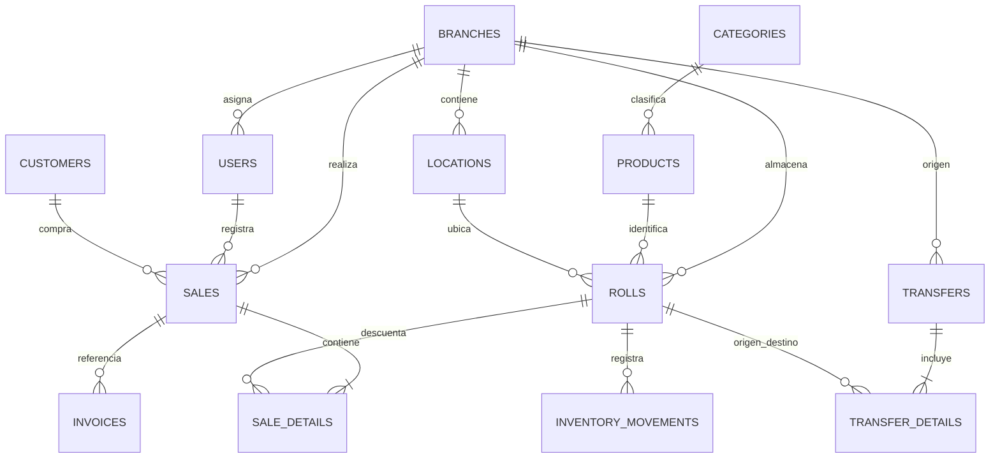

# Diagrama entidad-relación

## Reglas clave
- `rolls.meters_available` no debe ser negativo.
- La venta descuenta metros del rollo seleccionado.
- La transferencia crea un rollo de destino con el metraje transferido y registra movimientos en ambas sucursales.
- El historial no debe borrarse para corregir operaciones: en una siguiente etapa se implementarán anulaciones y movimientos compensatorios.
